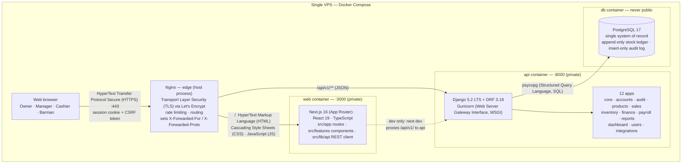

<p align="center">
  
</p>

<h1 align="center">Barkot Bar &amp; Restaurant — Business Operations System</h1>

<p align="center">
  <strong>The internal operations and control system for Barkot Bar &amp; Restaurant (Addis Ababa).</strong><br/>
  Point of sale · Inventory · Finance · Monthly payroll — all behind role-based access control.
</p>

<p align="center">
  
  
  
  
  
  
</p>

---

Barkot keeps the bar accountable day to day. It records every sale, tracks every bottle that enters
or leaves the shelf, counts the money coming in against the money going out, and runs monthly
payroll — with a permanent audit trail of who did what.

Four positions use it, each seeing only what their role allows: **Owner**, **Manager**,
**Cashier**, and **Barman**.

**Currency:** Ethiopian Birr (ETB). **Business timezone:** Africa/Addis_Ababa (timestamps stored in
Coordinated Universal Time, UTC).

---

## Table of contents

1. [Project status](#project-status)
2. [What it does](#what-it-does)
3. [Architecture](#architecture)
4. [Stack and dependencies](#stack-and-dependencies)
5. [Authentication and authorization](#authentication-and-authorization)
6. [Security](#security)
7. [Domain and database design](#domain-and-database-design)
8. [API design](#api-design)
9. [Testing and CI](#testing-and-ci)
10. [Getting started](#getting-started)
11. [Deployment and operations](#deployment-and-operations)
12. [Observability](#observability)
13. [Engineering notes and major decisions](#engineering-notes-and-major-decisions)
14. [Repository structure](#repository-structure)
15. [Conventions](#conventions)
16. [Documentation](#documentation)
17. [Open decisions](#open-decisions)

---

## Project status

| Area | State |
| --- | --- |
| **Backend** | Django 5.2 Long-Term Support (LTS) + Django REST Framework (DRF) — 12 Django apps, a complete Application Programming Interface (API) under `/api/v1/`, and an OpenAPI (Open API Specification) schema with zero validation errors |
| **Frontend** | Next.js 16 — login, dashboard, sales, inventory, finance, payroll, reports, settings, and refusal states |
| **Auth & security** | Session auth, Cross-Site Request Forgery (CSRF) protection, the role matrix (27 capabilities × 4 roles), layered rate limiting, production hardening |
| **Tests** | 1,471 backend · 125 frontend unit · 48 stubbed + 19 live End-to-End (E2E) tests |
| **Continuous Integration (CI) gates** | ruff (lint + format), mypy, `makemigrations --check`, OpenAPI validation, ESLint, Prettier, `tsc`, Vitest, Playwright |
| **Hardening (Phase D)** | Rate limiting, audit coverage, E2E suites, backups + restore drill, production runbook, observability, and a local deployment rehearsal — complete |
| **Deployment** | The production stack (`db` + `api` + `web`) is rehearsed locally from `docker-compose.prod.yml`; the target-host Virtual Private Server (VPS) rehearsal is **blocked on client decisions 9 and 10** |

Phases A–C (auth, products, sales, inventory, finance, payroll, reports, settings, dashboard) and
Phase D (hardening) are complete; Phase E (optional integrations) is deferred until the client
decides on a payment provider, fiscal/e-invoicing, and email — see [Open decisions](#open-decisions).

---

## What it does

| Module | What it covers |
| --- | --- |
| **Sales** | Record a sale, print a reference `S-YYYYMMDD-NNNN`, take cash or mobile-money, void a sale with a reason |
| **Inventory** | Receive stock, record breakage/waste, run physical counts and approve variances — all as an append-only movement ledger |
| **Products** | Product catalogue, categories, price history with validity windows, crate/bottle quantity modes |
| **Finance** | Expenses with categories (create/edit/delete with approval), and a derived balance (income − expenses − payroll) |
| **Payroll** | Monthly runs, per-employee payslips frozen at approval, deductions (advance, absence, late, other) |
| **Reports** | Financial, inventory and payroll tabs, each downloadable as a PDF; CSV remains available on the API for compatibility |
| **Dashboard** | The day's headline numbers |
| **Settings & users** | Staff accounts, roles, and business settings (Owner-only) |

A detailed build plan with per-phase gates lives in [`docs/roadmap.md`](docs/roadmap.md).

**Read first, in order:** this README → [`docs/roadmap.md`](docs/roadmap.md) →
[`docs/ENGINEERING_HANDOFF.md`](docs/ENGINEERING_HANDOFF.md) → the four Architecture Decision Records
(ADRs) in [`docs/architecture/ADR/`](docs/architecture/ADR/).

---

## Architecture

Barkot is a **two-tier web application with a modular backend**: a Next.js frontend talks to a
Django REST (Representational State Transfer) API over JSON (JavaScript Object Notation), and Django
is the only thing allowed to touch PostgreSQL. The frontend and backend share no code — they
communicate exclusively through the versioned REST contract at `/api/v1/`, and are built, tested and
deployed independently.

### Production topology



Three things the diagram makes explicit, all of which are rules the code enforces:

- **Nginx runs on the host**, not in a container. The `api`, `web` and `db` containers bind only to
  `127.0.0.1`; PostgreSQL is never reachable from outside the Docker private network.
- **The browser never touches the database.** Every data operation goes through the Django API,
  which authenticates the session and checks permissions before it reads or writes a row.
- **In development there is no Nginx.** The Next.js dev server proxies `/api/v1/` to Django itself
  (the dashed line), so the browser still talks to a single origin — no Cross-Origin Resource Sharing
  (CORS) issues, and cookies behave exactly as they do in production.

**How a request flows.** The browser signs in once and holds an HttpOnly session cookie. Every page
load is HTML from the `web` container; every data operation is a JSON call to `/api/v1/**`, which
Nginx forwards to the `api` container. Django authenticates the session, checks the permission for
that specific action, applies the business rules, writes to PostgreSQL, and logs the operation to
the audit trail. The frontend's own permission checks are only for hiding controls — the API is the
enforcement point.

### Development topology

The dev stack runs the same three services with **hot reload** and the source bind-mounted from your
checkout:

| Service | Runtime | Host port | What it is |
| --- | --- | --- | --- |
| `db` | PostgreSQL 17 | `127.0.0.1:5433` | Named volume `db_data` |
| `api` | Django (`runserver`) | `127.0.0.1:8000` | `./backend` bind-mounted, auto-reloads |
| `web` | Next.js dev server | `127.0.0.1:3000` | `./frontend` bind-mounted, auto-reloads; proxies `/api/v1/` → `api:8000` |

> **Why port 5433?** Many developer machines already run PostgreSQL on the default port 5432, so the
> dev database is published on `127.0.0.1:5433`. In production the database stays on 5432 *inside*
> the Docker network and is never published to the host at all.

### Design principles

- **One system of record.** PostgreSQL. Reports and dashboards are views over transactions, never a
  second source of truth.
- **Ledger, not mutable state.** Inventory is an append-only movement ledger; current stock is the
  sum of movements. There is deliberately no `stock` column on a product.
- **Correct, never overwrite.** A record is voided with a mandatory reason rather than deleted, and
  financial/payroll figures are frozen once approved.
- **Money is `Decimal` / `NUMERIC(14,2)`**, never a float. Each sale line stores the exact price
  that was charged, plus a pointer to the price row it came from.
- **The backend is authoritative.** The User Interface (UI) hides what a role cannot do, but every
  endpoint re-checks permissions itself.
- **Everything sensitive is audited** — actor, timestamp, entity, action, before/after JSON, IP
  (Internet Protocol) address.
- **Idempotent multi-step operations.** Completing a sale, receiving stock, finishing a count, and
  approving payroll are atomic and safe to retry.

---

## Stack and dependencies

### Frontend — `frontend/`

| Technology | Version | Role |
| --- | --- | --- |
| Next.js | 16 (App Router, Turbopack) | Routing, server rendering, production build |
| React | 19 | UI |
| TypeScript | 5.9 | Types |
| Tailwind CSS | 4 | Styling (design tokens in `globals.css`) |
| Recharts | 3 | Charts on the dashboard and reports |
| lucide-react | 1 | Icons |

Development tools: ESLint (`eslint-config-next`), Prettier, Vitest + Testing Library + jsdom
(unit), Playwright (end-to-end), Node **24** or newer.

Install and run:

```bash
cd frontend
npm ci          # always from the lockfile
npm run dev     # http://localhost:3000
```

### Backend — `backend/`

| Technology | Version | Role |
| --- | --- | --- |
| Django | 5.2 LTS | Web framework, Object-Relational Mapper (ORM), auth, sessions |
| Django REST Framework | 3.18 | The REST API |
| psycopg | 3 | PostgreSQL driver |
| django-filter | 25 | List-endpoint filtering |
| drf-spectacular | 0.29 | OpenAPI schema (`/api/schema/`, `/api/docs/`) |
| Gunicorn | 23 | Production WSGI server |

Development tools: pytest + pytest-django (tests), ruff (lint + format), mypy + Django/DRF stubs
(type checking), Python **3.14**.

Requirements are split by environment and pinned in `backend/requirements/`:

- `base.txt` — runtime dependencies shared by every environment
- `dev.txt` — includes `base.txt`, plus the test and lint toolchain
- `prod.txt` — includes `base.txt`, plus Gunicorn and Whitenoise
- `requirements.lock` — exact resolved versions for reproducible installs

Install and run:

```bash
cd backend
python -m venv .venv
.venv/bin/pip install -r requirements/dev.txt     # Windows: .\.venv\Scripts\pip ...
.venv/bin/python manage.py runserver 8000         # Windows: .\.venv\Scripts\python ...
```

Full details in [`backend/README.md`](backend/README.md).

### Data and infrastructure

| Technology | Version | Role |
| --- | --- | --- |
| PostgreSQL | 17 | The single system of record |
| Docker Compose | — | Dev stack (`docker-compose.yml`) and production stack (`docker-compose.prod.yml`) |
| Nginx | — | TLS termination, rate limiting, routing (production, on the host) |
| Redis / Celery | — | **Not yet used.** Added only when a real async workload appears |

---

## Authentication and authorization

### Sessions, not tokens

Authentication is **session-based** (Django database sessions + DRF `SessionAuthentication`). There
is no API key, no JSON Web Token (JWT), and no `django.contrib.admin` — the system's own UI is the
only way in. This is deliberate: the only client is the same-origin web app, so shrinking the surface
is a feature.

| Endpoint | Purpose |
| --- | --- |
| `GET  /api/v1/auth/csrf/` | Issue a CSRF token and set the `csrftoken` cookie |
| `POST /api/v1/auth/login/` | Sign in (rate limited 5/min per address); returns the user profile |
| `POST /api/v1/auth/logout/` | Sign out (204) |
| `GET  /api/v1/auth/me/` | Current user, role, and effective permissions |
| `POST /api/v1/auth/change-password/` | Change the password (rotates the session hash) |

> `GET` reads a record; `POST` creates or changes one. These are the two standard methods of HTTP
> (HyperText Transfer Protocol), the protocol the browser uses to talk to the server.

What to know:

- **CSRF.** The token is fetched from `GET /auth/csrf/` and echoed in the `X-CSRFToken` header on
  unsafe requests. The session cookie is `HttpOnly` (not readable by scripts); the CSRF cookie is
  deliberately readable.
- **Idle timeout.** Sessions expire after a configurable inactivity window (**8 hours** by default,
  an Owner setting). An expired session answers `403 session_expired` — deliberately not 401, so a
  client can tell "was logged in, timed out" from "never logged in".
- **Forced password change.** An account flagged `is_temporary_password` can reach exactly four
  endpoints (`me`, `csrf`, `change-password`, `logout`); everything else answers
  `403 password_change_required` until the password is changed.
- **Login rate limiting.** 5 attempts per minute per client address, counted in the database cache
  so the budget is shared across Gunicorn workers. The 6th attempt in a minute gets
  `429 throttled` + `Retry-After`.
- **Uniform failures.** Bad credentials return a plain `400 validation_error`; the server never
  reveals whether a username exists. Both successes and failures are audited.

### Roles and the permission matrix

Every user belongs to exactly one of four roles. Each role grants a fixed set of Django
permissions defined in a single constant, `ROLE_MATRIX`
(`backend/apps/accounts/permissions.py`), seeded into the database and reviewed by the Owner.

| Permission | Owner | Manager | Cashier | Barman |
| --- | :-: | :-: | :-: | :-: |
| `products.view_products` · `inventory.view_inventory` | ✔ | ✔ | ✔ | ✔ |
| `inventory.receive_stock` · `record_breakage` | ✔ | ✔ | – | ✔ |
| `inventory.complete_stock_count` | ✔ | ✔ | ✔ | – |
| `inventory.approve_adjustment` | ✔ | ✔ | – | – |
| `sales.view_sales` · `create_sale` | ✔ | ✔ | ✔ | – |
| `sales.void_sale` | ✔ | ✔ | – | – |
| `products.manage_categories` · `manage_products` · `change_prices` | ✔ | – | – | – |
| `finance.view_reports` · `create_expense` · `approve_expense` · `manage_expense_categories` | ✔ | ✔ | – | – |
| `payroll.view_payroll` · `generate_run` · `create_deduction` · `manage_payroll_employees` | ✔ | ✔ | – | – |
| `payroll.approve_run` · `mark_paid` | ✔ | – | – | – |
| `users.manage_employees` | ✔ | ✔ | – | – |
| `audit.view_audit_log` | ✔ | ✔ | – | – |
| `accounts.manage_users` · `manage_roles` · `manage_settings` | ✔ | – | – | – |

Totals: **Owner 27**, **Manager 19**, **Cashier 5**, **Barman 5** (out of 27 capabilities).

**How it is enforced.** Each capability has its own DRF permission class (for example
`CanApprovePayrollRun`) that calls `user.has_perm(...)`. The permission backend resolves
*role grants ∪ direct user grants ∪ group grants*, so the verdict always reflects the matrix rows
above — never a second copy of them. Apply a matrix change with `manage.py bootstrap_roles`
(plus `--check` in CI); a 4 × 27 cross-product test pins the whole matrix.

**Separation of duties.** One deliberate split: the Manager *generates* a payroll run, but only the
**Owner** *approves* it and marks it paid. Whoever computes a figure must not sign it off.

### Creating the first Owner

- `manage.py create_owner <username>` creates the first and only Owner. The password is read from a
  no-echo prompt or stdin — never from an argument or an environment variable.
  `--generate-password` prints a random 24-character password once and flags it as temporary.
- Roles are seeded automatically on `migrate` and verified by `manage.py bootstrap_roles --check`.
- The Owner is **not** a Django superuser; its authority comes entirely from the matrix.

---

## Security

### Production hardening

| Setting | Value |
| --- | --- |
| `DEBUG` | `False`, hard-coded — there is no `DJANGO_DEBUG` escape hatch |
| `SESSION_COOKIE_HTTPONLY` | `True` (invisible to JavaScript) |
| `SESSION_COOKIE_SECURE` / `CSRF_COOKIE_SECURE` | `True` by default in production |
| `SESSION_COOKIE_SAMESITE` / `CSRF_COOKIE_SAMESITE` | `Lax` |
| `SECURE_SSL_REDIRECT` | On when `DJANGO_SECURE_SSL_REDIRECT=true` (compose default) |
| `SECURE_HSTS_SECONDS` | 1 year, include-subdomains, preload |
| `SECURE_CONTENT_TYPE_NOSNIFF` / `X_FRAME_OPTIONS` | `nosniff` / `DENY` |
| Renderers / parsers | JSON only — no HTML browsable API |

### Anti-abuse

- **Secret-key guard.** Production refuses to boot without a `DJANGO_SECRET_KEY` that is set,
  distinct from the development placeholder, and at least 50 characters. A refused start beats a
  forged session.
- **No secrets in Git.** `.env` is gitignored; [`.env.example`](.env.example) documents every
  variable.
- **Layered rate limits.** Nginx at the edge (login 10/min, API 60/min) and Django in the app
  (login 5/min, writes 60/min). Reads are never throttled.
- **Trusted-proxy discipline.** `X-Forwarded-For` is ignored unless `DJANGO_TRUSTED_PROXY=true`, so
  an attacker cannot pick a fresh throttle bucket per attempt.
- **Audit trail.** Sales, stock movements, breakages, expenses, payroll, price changes, logins and
  permission changes all write insert-only `AuditLog` rows.

---

## Domain and database design

Shared building blocks live in `backend/apps/core/` and are reused by every domain app:

- `MoneyField` = `NUMERIC(14,2)`, `QuantityField` = `NUMERIC(12,3)` — money is never a float.
- `TimeStampedModel` / `ActorStampedModel` — every row records when it changed and who did it.
- `VoidableModel` — records are voided with a mandatory reason, never deleted; `objects` hides voided
  rows, `all_rows` includes them.
- `AppendOnlyModel` — `save()` refuses updates and `delete()` always refuses (used by the stock
  ledger and the audit log).
- `IdempotencyRecord` — a unique `(scope, key)` claim that makes retries safe.

### Sales — `backend/apps/sales/`

- **`Sale`** — unique reference `S-YYYYMMDD-NNNN`, status COMPLETED/VOIDED, `sold_at`, and
  denormalised totals. Voiding requires a reason and posts compensating stock movements.
- **`SaleItem`** — product, quantity, and the **`unit_price` frozen at sale time**, with a
  `price_source` foreign key to the exact `ProductPrice` row used.
- **`Payment`** — CASH or MOBILE_BANKING, amount, optional external reference. Reports build income
  from `Payment` rows, never from stored totals.
- **Idempotency.** Clients send an `Idempotency-Key`; the same key replays the first response instead
  of creating a duplicate. Daily receipt numbers are allocated under a transaction-scoped
  `pg_advisory_xact_lock`, so two concurrent cashiers never get the same reference.

### Inventory — `backend/apps/inventory/`

- **`StockMovement`** — an **append-only ledger**. Current stock is the sum of movements. Kinds:
  RECEIPT, SALE, SALE_VOID, BREAKAGE, COUNT_VARIANCE, STOCK_IN, STOCK_OUT. Each movement has exactly
  one source (enforced by a check constraint) and a direction derived from its kind, never hand-set.
- **`StockReceipt`** — DRAFT → COMPLETED; receiving posts RECEIPT movements.
- **`StockCount`** — DRAFT → COMPLETED → APPROVED. The count snapshots the ledger balance at line
  creation; **only approval writes COUNT_VARIANCE movements**, and only a Manager or Owner can
  approve. A Cashier may count but not approve.

### Finance — `backend/apps/finance/`

- **`ExpenseCategory`** — names an expense type. Managers and Owners can create, edit and delete
  (archive) them from the Expenses screen; deletion hides the category from new expenses while
  keeping historical records intact.
- **`Expense`** — category, amount, business-local `incurred_on`, status RECORDED → APPROVED →
  VOIDED. Only approved, non-voided expenses count in reports.
- **Balance is derived, never stored:** income = sum of `sales.Payment`, minus approved expenses,
  minus approved payroll.

### Payroll — `backend/apps/payroll/`

- **`Employee`** — the payroll-side record (1:1 with the `EmployeeProfile` person) carrying
  `monthly_wage`.
- **`PayrollRun`** — one per month: GENERATED → APPROVED → PAID (or CANCELLED). The Manager
  generates; the Owner approves and marks paid. Totals are computed, never typed.
- **`PayrollItem`** — per-employee gross, deductions and net, frozen at approval. Deductions may not
  exceed gross.
- **`PayrollDeduction`** — type (ADVANCE, ABSENCE, LATE, OTHER), amount, reason, date. Statutory
  deduction types are deliberately absent until the client specifies the calculation rules.

### Users and audit — `backend/apps/users/`, `backend/apps/audit/`

- **`EmployeeProfile`** — the *person* (full name, position, start date); archived, never deleted,
  optionally linked to a login account.
- **`AuditLog`** — insert-only: actor, action (CREATE/UPDATE/DELETE/VOID/LOGIN/LOGOUT/FAILED_LOGIN/
  APPROVE), object type + id, summary, before/after JSON, IP, and UTC timestamp.

The ADR-level rationale for the important choices is in
[`docs/architecture/ADR/`](docs/architecture/ADR/).

---

## API design

- **Versioned** at `/api/v1/` (DRF namespace versioning). The OpenAPI schema and interactive docs
  are at `/api/schema/` and `/api/docs/`, beside the version so a v1 client never needs to know
  about v2.
- **One error envelope for every failure:**

  ```json
  {"error": {"code": "validation_error", "message": "…", "details": {"field": ["…"]}}}
  ```

  The codes distinguish *client* mistakes (`validation_error`, `not_found`), *session* states
  (`not_authenticated`, `session_expired`, `password_change_required`), *authorization*
  (`permission_denied`), *business rules* (`insufficient_stock`, `invalid_state_transition`,
  `immutable_record`, `idempotency_key_reuse` — all 409), and *abuse* (`throttled`, 429).
- **Pagination** with a hard cap: default page size 20, maximum 200 (`/?page_size=`), response shape
  `{count, page_size, page, pages, results}`.
- **Health probes** at `/health/live` (process is up) and `/health/ready` (database reachable;
  returns 503 when it is not).
- Every endpoint that satisfies the contract (auth, envelope, JSON, pagination, version) is verified
  automatically by the contract suite — see below.

---

## Testing and CI

Testing is layered: fast isolated checks first, deep integration in the middle, and a real browser
against a real stack at the top.

| Layer | Tool | Scale | What it proves |
| --- | --- | --- | --- |
| Backend unit / integration | pytest | 1,471 tests | Domain invariants, the full permission-matrix cross-product, session rules, throttles, idempotency under real thread contention, production config guards |
| API contract suite | `backend/tests/api/contract.py` | auto-discovery | Every mounted endpoint satisfies the invariant rules (auth, envelope, JSON, pagination, version). A new endpoint is checked automatically |
| Access sweep | `backend/tests/api/test_access_sweep.py` | every route | Real signed-out requests assert 401/403 with the correct envelope; pinned non-vacuous and mutation-checked |
| Endpoint audit | `backend/tests/api/test_audit_coverage.py` | every write endpoint | Each state-changing endpoint writes exactly one audit row per scenario |
| Frontend unit | Vitest + Testing Library | 125 tests | Component and logic behaviour |
| E2E — stubbed | Playwright | 48 tests | Screens against stubbed states a real server will not produce on demand (dead backend, 502, forced password change) |
| E2E — live | Playwright | 19 tests | A browser against a real Django + Postgres: real session, real CSRF, real 403, real rows. A stub cannot catch frontend/backend drift; this half can |

**CI** (`.github/workflows/ci.yml`, GitHub Actions) runs the same gates on `main` and on pull
requests:

- **Backend** — `ruff check`, `ruff format --check`, `mypy`, `pytest`, `makemigrations --check`, and
  OpenAPI validation.
- **Frontend** — ESLint, Prettier, `tsc --noEmit`, Vitest, and a production build.
- **E2E** — the stubbed suite, then the live suite, as two separate invocations. The live project
  starts its own Django on port 8010 against a disposable `*_e2e` database and reseeds it each run
  (`seed_e2e --reset` refuses to flush any database whose name does not end in `_e2e`).

Mirror the pipeline locally with the root `Makefile`: `make ci` (POSIX — Portable Operating System
Interface — shell), or run each app's commands directly.

---

## Getting started

### Fastest path — the whole stack in Docker

```bash
git clone https://github.com/NahumDm/barkot_internal_system.git
cd barkot_internal_system
docker compose up -d                                   # db + api + web, hot reload
docker compose exec api python manage.py create_owner owner
# open http://localhost:3000  (redirects to /dashboard)
```

### Per-app, without Docker for the code

1. **Database** (the only container you need): `docker compose up -d db`
2. **Backend:** `cd backend`, create a virtualenv, `pip install -r requirements/dev.txt`, then
   `manage.py runserver 8000`. See [`backend/README.md`](backend/README.md).
3. **Frontend:** `cd frontend`, `npm ci`, `npm run dev` → http://localhost:3000

### Running the tests

```bash
make ci                        # local parity with the CI pipeline (POSIX shell)

# or individually:
cd backend  && .venv/bin/python -m pytest          # backend suite
cd frontend && npm run lint && npm run test        # lint + vitest

cd frontend && npm run test:e2e:stubbed            # stubbed E2E (Node only, no database needed)
E2E_DB_PASSWORD='<password>' npm run test:e2e:live # live E2E (starts its own Django)
```

---

## Deployment and operations

### Design

- One VPS running Docker Compose: `db` (PostgreSQL), `api` (Gunicorn), `web` (Next.js standalone).
  Host Nginx terminates TLS and proxies.
- `docker-compose.prod.yml` is the production definition; [`.env.example`](.env.example) documents
  every required variable. Production refuses to boot without a real secret key and pins `DEBUG` off.
- Roles are seeded on `migrate`; only the Owner account is created explicitly.

### Deployment sequence

```bash
git clone https://github.com/NahumDm/barkot_internal_system.git
cd barkot_internal_system
cp .env.example .env            # fill in real secrets (secret key ≥ 50 chars, database password)
docker compose --env-file .env -f docker-compose.prod.yml up -d --build
docker compose --env-file .env -f docker-compose.prod.yml exec api python manage.py migrate --no-input
docker compose --env-file .env -f docker-compose.prod.yml exec -it api python manage.py create_owner owner
sudo cp infrastructure/nginx/nginx.conf /etc/nginx/nginx.conf
sudo cp infrastructure/nginx/conf.d/barkot.conf /etc/nginx/conf.d/barkot.conf
sudo nginx -t && sudo systemctl reload nginx
```

### Runbooks

| Document | Covers |
| --- | --- |
| [`docs/runbooks/production.md`](docs/runbooks/production.md) | Initial deployment, service operations, backup/restore, rollback, troubleshooting, verification checklist |
| [`docs/runbooks/backup-restore.md`](docs/runbooks/backup-restore.md) | Daily `pg_dump` backups, restore, and the automated restore drill into a scratch database |
| [`docs/runbooks/deployment-rehearsal.md`](docs/runbooks/deployment-rehearsal.md) | Full-stack rehearsal checklist, with the executed local rehearsal logged (2026-10-08) |

**Backups** (`infrastructure/scripts/`): `backup.sh` (pg_dump), `restore.sh`, and `restore-drill.sh`
— which backs up, restores into a scratch database (`barkot_restore_drill_<timestamp>`), and
reconciles row counts. An untested backup is only a hypothesis. A Windows equivalent
(`restore-drill.ps1`) documents the same procedure.

**Rehearsal status.** The full-stack gate passed in a **local rehearsal** (2026-10-08): images built,
stack up, migrations applied, `/health/live` and `/health/ready` returning 200, Owner login 200,
`X-Request-ID` present, `nginx -t` clean. The remaining milestone — a real Ubuntu 24.04 VPS with a
domain and Let's Encrypt certificates — is blocked on the client's provider decision (open
questions 9 and 10).

---

## Observability

- **Request context.** Every request carries a `request_id` (from Nginx's `$request_id` or generated
  locally), echoed in the `X-Request-ID` header and attached to log records along with the acting
  `user_id`.
- **Structured logs** in both dev and prod include `request_id` and `user_id`, so a user action can
  be traced across the requests that produced it.
- **Health probes** (`/health/live`, `/health/ready`) are consumed by Docker healthchecks and
  Nginx; `/health/ready` turns 503 when the database is unreachable.
- **Alerting guidance** (in the production runbook): alert on the 5xx rate, on `/health/ready`
  returning 503, and on `/health/live` failing.

---

## Engineering notes and major decisions

The full write-ups are in [`docs/roadmap.md`](docs/roadmap.md). These highlights explain why the
design looks the way it does:

1. **Session auth avoids a recursion trap.** Reading `request.user` from inside the authenticator
   recursed into a stack overflow when a session expired. Sessions are now ended by flushing the
   session directly, never by calling `logout()`.
2. **The password policy was not rejecting anything.** Django 5.2 raises `ValidationError`, not a
   non-existent `PasswordValidationError`; the old `except` clause threw an `AttributeError` while
   handling a rejection, turning every refusal into a 500.
3. **The forced-password rule had made its own endpoint unreachable.** The CSRF view sat outside the
   allow-list, so a user on a temporary password could not fetch a token to change it. The allow-list
   is exactly four views, pinned by a test.
4. **The permission gate used to be a test stand-in.** An old test URLconf defined its own permission
   classes, so "Cashier cannot approve payroll" was true of a test, not the app. Shipped permission
   classes now resolve through `has_perm` against the matrix, and a 4 × 27 test pins it.
5. **401s were assumed, not verified.** An access sweep of real signed-out requests over every route
   surfaced that the API docs view answered 401 outside the JSON envelope. Those responses are now
   asserted on exactly what they do.
6. **Duplicate-sale retries are impossible by design.** The same `Idempotency-Key` replays the first
   result; a fingerprint hashes canonicalised `Decimal` amounts (never their string form) and the
   caller's `sold_at`; the daily reference counter runs under a `pg_advisory_xact_lock`.
7. **TLS-in-front is trusted only when the proxy is trusted.** `SECURE_PROXY_SSL_HEADER` is wired
   only behind `DJANGO_TRUSTED_PROXY=true`; without it, `SECURE_SSL_REDIRECT` behind Nginx would
   redirect-loop.
8. **No admin, no API keys, no JWT.** The only client is the same-origin web app.

---

## Repository structure

```
barkot_internal_system/
├── frontend/              Next.js 16 + TypeScript app (App Router)
│   ├── src/app/           Routes and pages          (sales, inventory, finance, payroll, …)
│   ├── src/features/      Screen components         (auth, finance, payroll, reports, …)
│   ├── src/lib/api/       REST client for /api/v1/  (auth, sales, inventory, finance, …)
│   ├── src/components/    Shared UI + app shell     (layout, sidebar, nav)
│   ├── public/images/     Brand assets (barkot-lockup.png, logo, mark)
│   └── tests/             Vitest unit + Playwright E2E (stubbed and live)
├── backend/               Django 5.2 + DRF modular monolith
│   ├── apps/              12 apps — core, accounts, audit, products, sales,
│   │                      inventory, finance, payroll, reports, dashboard,
│   │                      users, integrations
│   ├── config/            Settings (dev / prod), URLs, health, logging
│   └── requirements/      base · dev · prod · lock
├── infrastructure/        Dockerfiles, Nginx config, backup/restore scripts
├── docs/                  Roadmap, ADRs, runbooks, handoff, client decisions
├── .github/workflows/     CI pipeline (backend · frontend · e2e)
├── docker-compose.yml     Dev stack  (db + api + web, hot reload)
├── docker-compose.prod.yml Production stack
├── Makefile               Local CI parity (lint, typecheck, test, …)
└── .env.example           Environment template — never commit .env
```

---

## Conventions

- **Branching:** `main` (production-ready), `staging` (release candidate), `feature/*`.
- **Commits:** conventional-style prefixes (`feat(backend):`, `docs(runbook):`, `style(backend):`);
  one logical change per commit.
- **Adding API surface** requires passing the contract suite and adding an audit scenario — both
  enforced automatically. See [`docs/ADDING_AN_ENDPOINT.md`](docs/ADDING_AN_ENDPOINT.md).
- **No secrets** in Git, in committed settings overrides, or in shipped test fixtures.

---

## Documentation

| Path | Contents |
| --- | --- |
| [`docs/roadmap.md`](docs/roadmap.md) | Phase-by-phase plan, gates, status, open questions |
| [`docs/architecture/ADR/`](docs/architecture/ADR/) | Architecture decision records 0001–0004 |
| [`docs/ENGINEERING_HANDOFF.md`](docs/ENGINEERING_HANDOFF.md) | Operator-facing state of the world, known gaps, verified gate baselines |
| [`docs/ADDING_AN_ENDPOINT.md`](docs/ADDING_AN_ENDPOINT.md) | Adding an endpoint without breaking the contract/audit/completeness gates |
| [`docs/runbooks/`](docs/runbooks/) | Production, backup-restore, deployment rehearsal |
| [`docs/business/client-decisions.md`](docs/business/client-decisions.md) | Open decisions that steer scope |
| [`docs/ui-ux/`](docs/ui-ux/), [`docs/architecture/`](docs/architecture/) | The client-authored User Interface and User Experience (UI/UX) and architecture specifications |

---

## Open decisions

None block the running system, but several set the remaining scope
([`docs/business/client-decisions.md`](docs/business/client-decisions.md)):

| # | Decision | Affects |
| --- | --- | --- |
| 4 | Stock-count frequency and a formal closing time (implies report cut-offs) | Reporting boundaries |
| 5 | Payroll additions, overtime, absences | Payroll |
| 6 | Deduction approval policy and statutory calculations | Payroll |
| 8 | Fiscal / e-invoicing technical requirements | Phase E |
| 9, 10 | Commercially permitted VPS provider and ETB payment method | **Deployment rehearsal and Phase E** |
